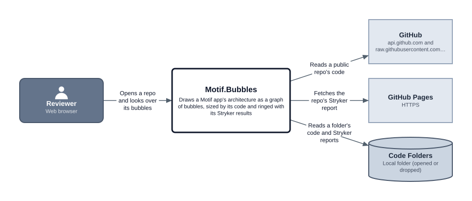
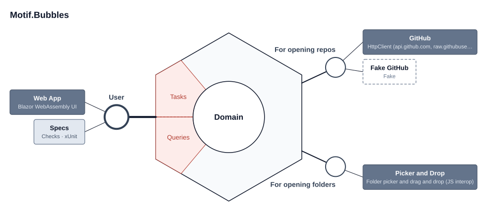

# Motif Bubbles

A tool in the **[Motif.NET](https://github.com/motif-dotnet)** suite. It draws a Motif app's architecture as it's built: a graph of bubbles for the Domain, the User Tasks and User Queries, the Application, each driven port with its real adapters and fakes, and the specs. Each bubble sits in its place in ports and adapters, is sized by its lines of code, is linked to what it uses, implements, extends and checks, and is ringed with how many of Stryker's mutants its specs catch.

It's a Blazor WebAssembly app for GitHub Pages: no server and no accounts. Open or drop a Motif repo's folder, or give a public GitHub repo.

The design is in the [Motif Bubbles design note](https://github.com/motif-dotnet/.github/blob/main/design/bubbles.md). The build is tracked in [motif-dotnet/.github#43](https://github.com/motif-dotnet/.github/issues/43).

## Design

### Context diagram



### Ports and adapters



These pictures are exported by [Motif Sketch](https://motif-dotnet.github.io/Motif.Sketch/) from [motif/sketch.motifsketch.json](motif/sketch.motifsketch.json). The [motif/](motif/) folder holds the design, the [solution plan](motif/plan.md) and the [glossary](motif/glossary.md).

## Status

**v1, preview.** Two ways in:

- **Open or drop a folder:** a Motif repo's root folder. Its rings come from the latest Stryker report in its `StrykerOutput/` folder.
- **A public GitHub repo** (`owner/name`, or a github.com address), read from its default branch, with a shareable `#repo=owner/name` link. Its rings come from the report its CI publishes to its Pages site, at `motif/mutation-report.json`.

The app reads the code itself, by Motif's conventions: `For…` ports, `For<Port>Via<Way>` adapters, fakes in folders named for their ports. A repo that strays from them is drawn less well. The graph has fixed columns and a row per driven port, sorted by name, so the same repo always looks the same. It pans and zooms. Hovering a bubble picks out its neighbours and shows its numbers. Each layer (size, rings, each kind of link, column bands) can be turned off to see what it adds. When there's no report, or the code has changed since it was made, a gentle note says so. Light and dark themes, and the same look as the other Motif tools from the suite's web kit.

Pointed at its own folder or repo, Motif Bubbles draws itself, and its specs use its own code as a fixture.

The scanner and the Stryker report reader live in `Motif.Bubbles.Domain`, with no package references, so the planned `dotnet motif` CLI can reuse them.

## Build and run

You need the .NET 10 SDK.

```
dotnet run --project Motif.Bubbles.App    # the app
dotnet test                               # the specs
dotnet tool restore && dotnet stryker     # mutation testing of the specs
```

Mutation testing uses [Stryker.NET](https://stryker-mutator.io/docs/stryker-net/introduction/), a .NET tool pinned in [dotnet-tools.json](dotnet-tools.json), set up by [stryker-config.json](stryker-config.json) over [Motif.Bubbles.Specs.slnx](Motif.Bubbles.Specs.slnx), so the browser specs stay out. It changes the code under the specs a little at a time and checks a spec fails each time. The reports are written to `StrykerOutput/`, where opening this folder in Motif Bubbles finds the latest one.

## Contributing

Bug reports, suggestions and pull requests are welcome; [CONTRIBUTING.md](https://github.com/motif-dotnet/.github/blob/main/CONTRIBUTING.md) says how. For ideas and questions, start a thread in [Discussions](https://github.com/motif-dotnet/.github/discussions).

## License

MIT, see [LICENSE](LICENSE).
